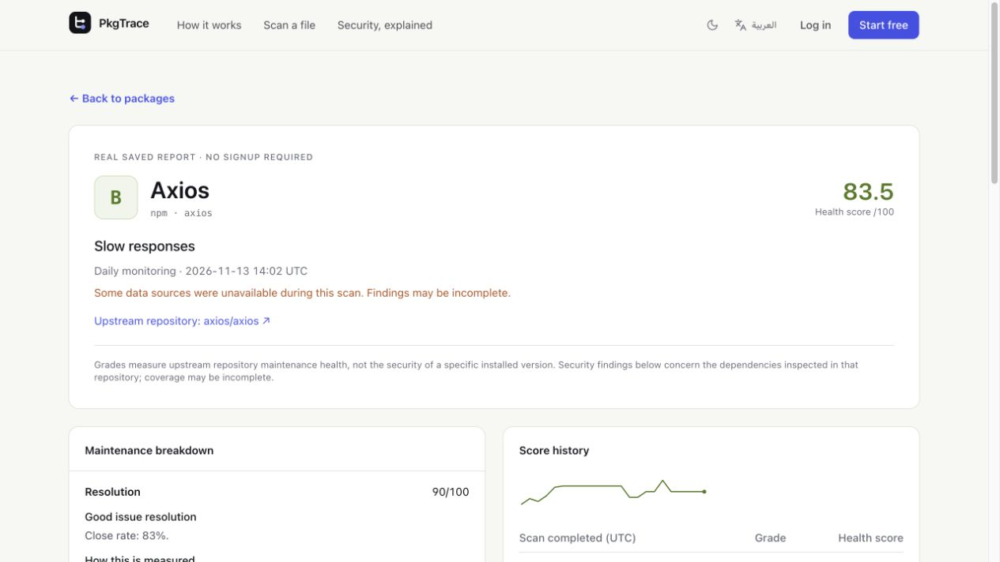
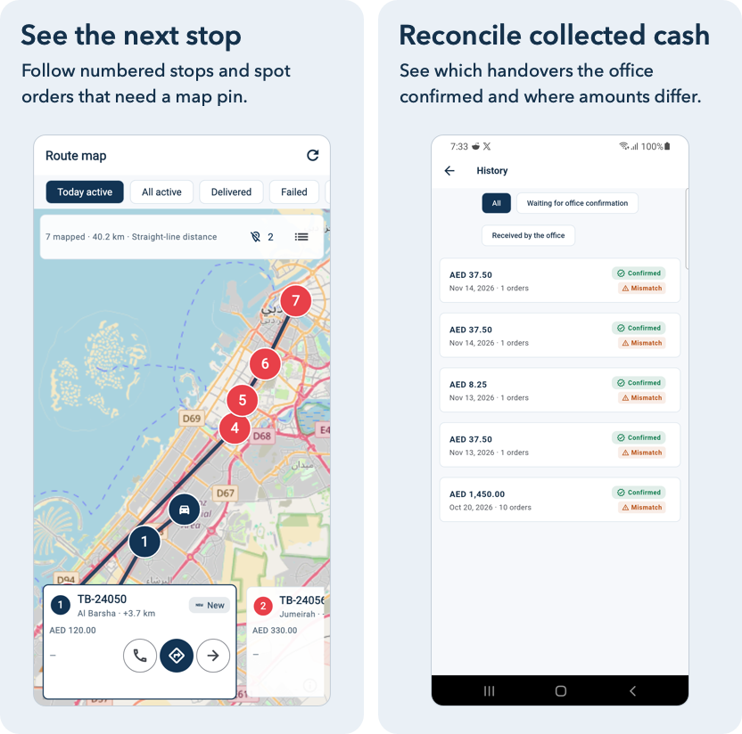
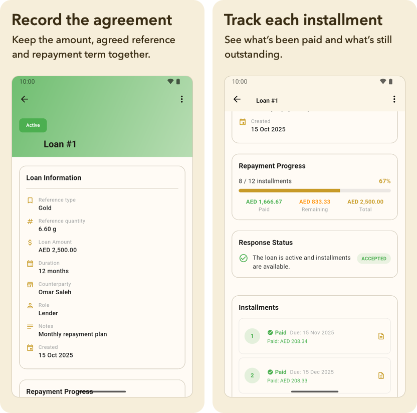
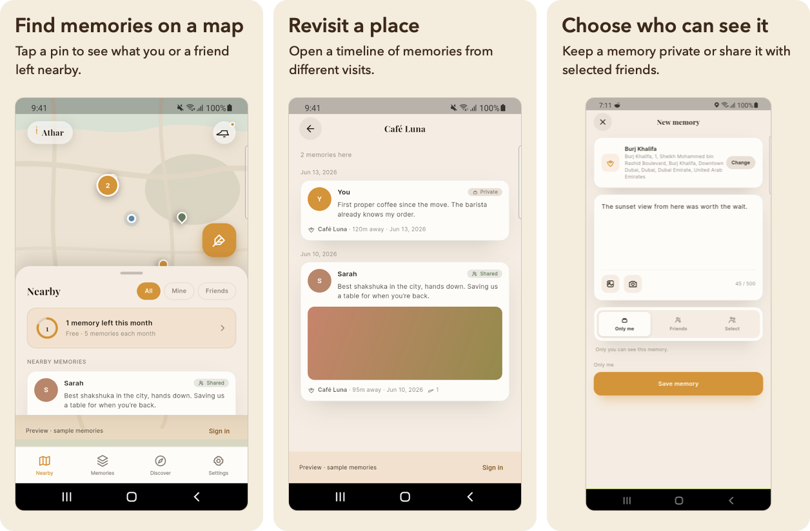
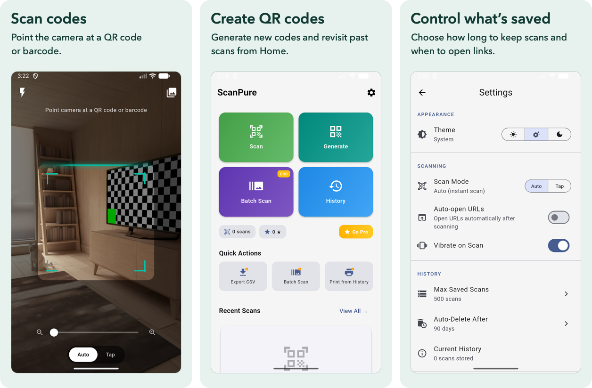

# Adam Ahmed

**Senior Backend Engineer & Technical Lead · Java / Spring Boot · Laravel**

I’m Adam Ahmed, a UAE-based senior backend engineer, technical lead, and founder of CodeFounders. I spent nearly five years building insurance and reinsurance platforms in the UAE. That work shaped how I build systems where pricing, approvals, and business rules have to stay consistent across teams and workflows.

At CodeFounders, I work across SaaS, commerce, applied AI, and bilingual web and mobile products. I work primarily with **Java / Spring Boot** and **Laravel**, with **Flutter** for mobile delivery. I take systems from architecture and data modeling through integration, release, and production support.

## Selected backend and product engineering projects

### Insurance & reinsurance · Individual and group business

Quoting an individual policy and pricing a group scheme can involve very different rules. Across motor, medical, and general insurance, teams need to keep the price, coverage, and terms aligned as a quote moves through review and into the policy workflow.

I worked on insurance and reinsurance platforms serving individual and group business across those three lines. I built Java and Spring Boot services that turned business rules into quoting, pricing, and policy workflows. I integrated those platforms with multiple insurance companies as well as CRM and marketing platforms. I helped grow and lead the engineering team while staying hands-on with delivery.

### PkgTrace · Developer Tools · Dependency Risk and Maintenance

When an npm package is compromised, engineers have to work out which builds pulled in an affected version. They also need a way to judge whether the project they depend on is still maintained without combing through GitHub issues and releases by hand.

[Read the Axios case study](case-studies/pkgtrace.md) · [Open the public Axios report](https://pkgtrace.com/packages/axios)

### Agents247 · Customer Support SaaS · Bilingual AI Chat

Visitors asking a simple question in Arabic or English may leave if nobody answers. When a question needs a person, the support team needs the conversation so the visitor can pick up where they left off.

[Visit Agents247](https://agents247.app/) · [Public bilingual chat preview](assets/agents247-chat-fresh.jpg)

### Trendpfy · E-commerce · Multi-vendor Marketplace

Shoppers looking for a compatible smart-home device have to compare similar listings across brands and sellers. Once they order, having to contact the seller for every delivery update adds another step.

[Browse Trendpfy](https://trendpfy.codefounders.tech/) · [Live marketplace catalog](assets/trendpfy-marketplace-fresh.jpg)

## Mobile apps and field operations

### DarbCrew · Delivery & Logistics · Driver Routes and Cash Handovers

A driver juggling several deliveries needs to see the next stop, which parcels are still in their custody, and what cash to collect at the door. By shift end, the office needs to know how much cash actually changed hands. A gap between the expected and received amounts is hard to trace when the order and the handover are recorded separately.

The driver map numbers stops and calls out orders missing a usable pin. Cash handovers stay linked to the delivered orders, so the office can confirm receipt and keep any mismatch visible.

[Visit DarbCrew](https://darbcrew.codefounders.tech/)

*Demo orders and handovers. Route distances are straight-line estimates. Basemap © OpenStreetMap contributors.*

### Katib · Personal Finance · Private Loans and Installments

Months into a private loan, the lender and borrower may remember the terms differently. When amounts, due dates, and repayments are scattered across messages and bank receipts, it’s hard to agree on what’s still owed.

[Katib on Google Play](https://play.google.com/store/apps/details?id=tech.codefounders.katib)

### Athar · Lifestyle · Location-based Memories

You can walk right past the café where a friend left you a memory and never think to search an old chat for it. Athar pins memories to the places they belong and can alert you when you come within range of one you’re allowed to see.

[Athar on Google Play](https://play.google.com/store/apps/details?id=app.athar&hl=en&gl=US) · [Explore Athar](https://oathar.app/)

*Android screenshots with sample memories.*

### ScanPure · Utilities · QR and Barcode Scanning

It’s tedious to type a long link from a sign or share it with someone standing next to you. A printed QR code is easier to pass around, but its destination is hard to judge at a glance.

[ScanPure on Google Play](https://play.google.com/store/apps/details?id=tech.codefounders.scanpure)

## Backend engineering and technical lead engagements

- **Backend architecture and technical leadership** for SaaS, insurance workflows, pricing engines, and products with multiple user roles.
- **Integration and production work** across REST APIs, payments, webhooks, database migrations, and release workflows.
- **Product delivery** for Arabic and English web and mobile apps, including Flutter releases and in-app purchases.

I’m open to hands-on backend and technical lead engagements, as well as scoped work on an existing product.

[CodeFounders](https://codefounders.tech/) · [LinkedIn](https://www.linkedin.com/in/adamoxy/)
