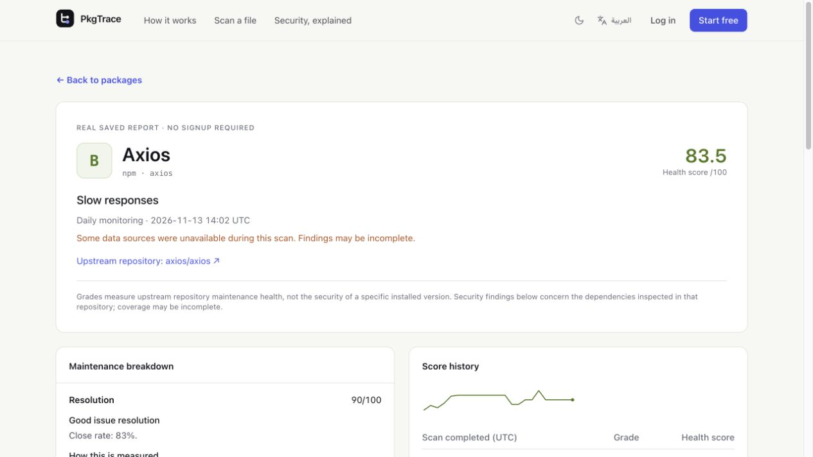

# Reviewing Axios after the March 2026 npm compromise

On March 31, 2026, an attacker used a compromised maintainer account to publish two malicious Axios versions to npm, `1.14.1` and `0.30.4`. Both pulled in `plain-crypto-js@4.2.1`. [Axios maintainer postmortem](https://github.com/axios/axios/issues/10636)

Imagine owning a Node.js service that uses Axios. You need to find which builds resolved one of those two versions. The version range in the manifest leaves that question open. Lockfiles and build records give you the exact versions to compare with the postmortem.

After that review, you still need to decide whether to keep depending on Axios. Answering that takes a different set of evidence, including how recently the project shipped a release, whether maintainers close issues, and how long users are waiting for replies. The November PkgTrace report brings those maintenance signals together and flags gaps in the available data. [Public Axios report](https://pkgtrace.com/packages/axios)

[Back to the profile](../README.md)
